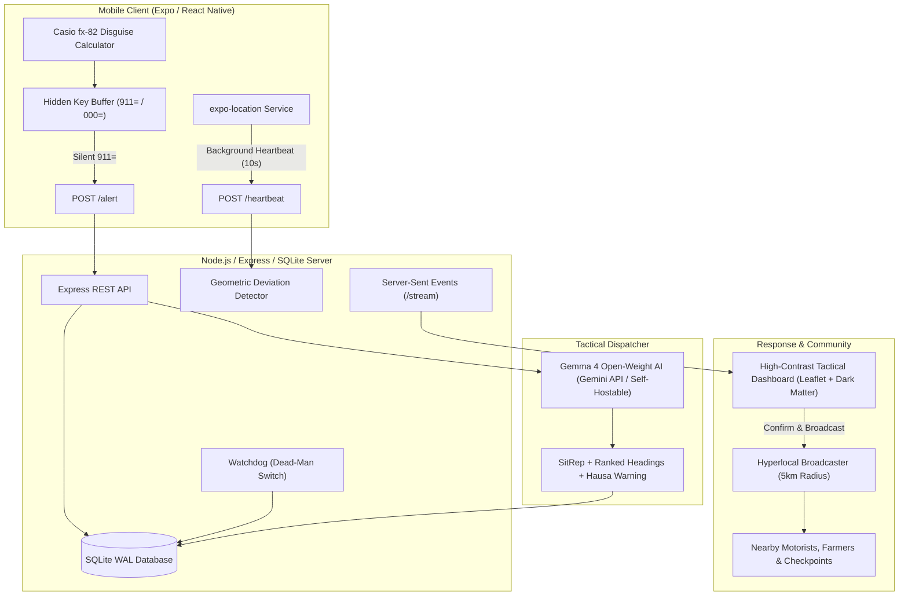

# ArewaSafe (Kariya AI) 🛡️🇳🇬
> Tactical Travel-Safety & Hyperlocal Community Warning System for Northern Nigerian Highways.  
> Built for **Hacktoberfest Hack Day**.

---

## 📌 Problem & Context

Interstate road travel in northern Nigeria (such as the vital **Kaduna–Zaria highway**, Abuja–Kaduna expressway, and Birnin Gwari corridor) poses severe security risks, including armed ambushes, banditry, and abductions. When commercial buses or private vehicles are targeted:
- Victims' phones are immediately seized or forced to turn off, preventing distress calls.
- Commuters attempting to use conspicuous emergency apps risk retaliatory violence if discovered.
- Ambushed vehicles are frequently forced off the paved highway into dense bush tracks at low speeds.
- Nearby farming communities, vigilante groups, and oncoming motorists receive no timely warning.
- Emergency response centers lack actionable, standardized situation reports (SitReps) and travel direction projections.

**ArewaSafe (Kariya AI)** bridges this gap with an undercover disguise mobile app, automated telemetry heuristics, open-weight AI tactical analysis, and immediate 5km hyperlocal community broadcasts.

---

## 🏗️ Architecture



---

## 🌟 The 6-Feature Vision

1. **Disguise Mobile Interface**: Looks and operates identically to an ordinary Casio scientific calculator (`fx-82`), with arithmetic, trigonometry (`sin`, `cos`, `tan`), parentheses, and powers.
2. **Hidden Panic & Arrival Triggers**: Typing `911=` triggers an instant emergency distress signal with live GPS coordinates, while evaluating normally on screen. Typing `000=` silently marks safe arrival.
3. **Dead-Man's Switch**: Automatic watchdog detects when active trips stop pinging without checking in, alarming after two consecutive missed intervals.
4. **Geometric Bush-Deviation Detector**: Real-time detection of vehicles departing the highway corridor into the bush (distance > 300m, off-axis angle > 60°, speed < 25 km/h).
5. **Tactical AI Dispatcher (Gemma 4)**: Translates raw coordinates and kinematics into concise situation reports, ranked likely heading projections with confidence scores, and vernacular **Hausa** community warnings.
6. **5km Hyperlocal Flash Broadcast**: One-click broadcast dispatch alerting recipients within a 5-kilometer radius of the incident.

---

## 📊 Built Today vs Roadmap

| Feature / Component | Status | Implementation Details |
| :--- | :---: | :--- |
| **Casio Disguise Calculator** | **BUILT** | Full scientific calculation, dual-line retro LCD, zero emergency indicators. |
| **Hidden Silent Panic Trigger (`911=`)** | **BUILT** | Hidden circular key buffer sends silent `POST /alert` with live GPS fix. |
| **Silent Arrival (`000=`)** | **BUILT** | Silently terminates active trip session (`POST /trips/:id/end`). |
| **Background GPS Telemetry** | **BUILT** | Periodic heartbeat with speed (km/h) and heading; silent error handling. |
| **Dead-Man's Switch** | **BUILT** | Server watchdog triggers `DEAD_MAN` alert after 2 missed heartbeat cycles. |
| **Bush-Deviation Detector** | **BUILT** | Vector analysis detecting slow perpendicular divergence from corridor. |
| **Multi-Corridor Highway Geofencing** | **BUILT** | Pre-calibrated GPS vectors for Kaduna–Zaria, Abuja–Kaduna, Birnin Gwari, and Kano–Katsina. |
| **Gemma 4 Tactical Dispatcher** | **BUILT** | Generates SitReps, ranked bearings, and Hausa warnings via Gemini API + fallback. |
| **Projector Tactical Dashboard** | **BUILT** | Regional sand & night themes, live tracks, SSE auto-reconnect, 5km circle inspection. |
| **In-Browser Demo Simulator & Chimes** | **BUILT** | 1-click scenario triggers directly in dashboard dock + synthesized Web Audio alert chimes. |
| **GSM SMS / Flash Broadcast Gateway** | **BUILT** | Dual telecom integration with Africa's Talking (pan-African) and Twilio in `server/broadcaster.js`. |
| **Under-Seat Blackbox Hardware** | **BUILT** | ESP32 + NEO-6M GPS + SIM800L C++ autonomous firmware in `hardware/blackbox.ino`. |
| **Standalone Android APK Support** | **BUILT** | EAS Build profile configured in `mobile/eas.json` for direct phone APK installation. |
| **SMS Heartbeat Fallback** | *ROADMAP* | Automated GSM SMS ping when cellular 3G/4G data is toggled off by an attacker. |
| **Sovereign Local Edge Inference** | *ROADMAP* | Running quantized Gemma 4 weights directly on local Linux servers in police barracks. |

---

## 🧠 Why Open-Weight AI (Gemma 4)?

ArewaSafe utilizes **Gemma 4** (accessed via the Gemini API with zero-config fallback):
- **Sovereign Deployment**: Security operations in rural northern Nigeria cannot rely exclusively on cloud APIs with recurring subscription fees or uninterrupted internet connectivity. Open-weight models like Gemma can be packaged, quantized, and deployed on self-hosted local infrastructure or rugged edge devices.
- **Bilingual Vernacular Generation**: Gemma can rapidly formulate concise situation reports for military and police command centers while producing natural, actionable **Hausa language** warnings for rural farming communities and village vigilantes (CJTF).
- **Format Integrity**: Consistently produces structured, machine-parsable JSON with probability distributions over anticipated headings.

> [!NOTE]
> **Hausa Review Notice**: The pre-configured fallback warning (*"Gargadi: an samu rahoton matsalar tsaro a hanyar Kaduna zuwa Zariya..."*) and AI-generated Hausa warnings should be reviewed by a native speaker before field deployment to ensure localized dialectal appropriateness.

---

## 🔒 Safety Safeguards & False Alarm Mitigations

1. **Two Missed Pings Rule**: The dead-man's switch requires two full missing heartbeat intervals (`MISSED_BEFORE_ALARM = 2`) before raising an alarm, ensuring temporary cellular dead zones don't trigger false panics.
2. **One Alert Per Type Per Trip**: The incident database suppresses duplicate alerts of the same type for an active trip, preventing notification storms.
3. **Human-in-the-Loop Confirmation**: By default, incident reports are held in `PENDING_CONFIRM` status until a human dispatcher validates the telemetry and authorizes community broadcast.
4. **Dual Independent Signal Auto-Confirmation**: If a trip triggers two distinct incident signals (e.g., a `BUSH_DEVIATION` followed by a `DEAD_MAN` signal loss, or `MANUAL` alert with `DEAD_MAN`), the server automatically upgrades status to `CONFIRMED` and dispatches broadcasts.

---

## 🚀 Quickstart & Setup

### Prerequisites
- Node.js 20.6+
- npm

### 1. Server & Dashboard Setup
```bash
cd server
npm install
cp .env.example .env
# Edit .env to supply your GEMINI_API_KEY and GEMMA_MODEL (optional; fallback operates without key)
npm start
```
The server will start on `http://localhost:3000`. The static high-contrast dashboard is served directly at `http://localhost:3000/`.

### 2. Demo Replay Driver
In a second terminal, execute the demo driver to simulate field scenarios:
```bash
# Scenario A: Bush Deviation (bus leaves road perpendicular at slow speed)
node scripts/replay.js deviation

# Scenario B: Dead-Man's Switch (abrupt signal loss)
node scripts/replay.js deadman

# Scenario C: Silent 911= Panic Trigger
node scripts/replay.js manual
```

### 3. Mobile Client (Disguise Calculator)
```bash
cd mobile
npm install
# Set your laptop's local LAN IP in mobile/src/config.ts
npx expo start
```
Open **Expo Go** on your Android device or iPhone and scan the QR code.

### 4. Production Verification Suite
Run the automated end-to-end production verification suite covering health checks, multi-corridor geofences, tactical PIN authorization, device tokens, telemetry deviation, and AI SitRep generation:
```bash
node scripts/verify-production.js
```

### 5. Production Docker Deployment
Launch the complete containerized stack with 1-click Docker Compose:
```bash
docker compose up -d
```
Monitor system health:
```bash
curl http://localhost:3000/health
```

---

## 🎬 End-to-End Demo Script

1. **Calculator Disguise**: Open the mobile app. Notice the realistic Casio `fx-82` scientific interface. Perform calculations like `sin(30) + 5 = 5.5`.
2. **Live Track on Dashboard**: Open `http://localhost:3000`. Run `node scripts/replay.js deviation`. Watch the vehicle appear as a blue track traveling along the Kaduna–Zaria highway corridor at 80 km/h.
3. **Bush Deviation Alert**: The simulated bus turns 90° off-road into the bush at 10 km/h. Within 2 strikes (>300m off-road), the server detects the ambush signature and triggers a `BUSH_DEVIATION` incident.
4. **SitRep & Heading Inspection**: On the dashboard, click the pulsing incident marker. Read the AI situation report, Hausa warning box, ranked escape bearings, and tactical checklist. A red 5km radius circle outlines the threatened zone.
5. **Confirm & Broadcast**: Click the prominent **Confirm & Broadcast** button. A green broadcast banner appears detailing how many recipients were reached within 5km.

---

## 📄 License
This project is licensed under the [MIT License](LICENSE).
